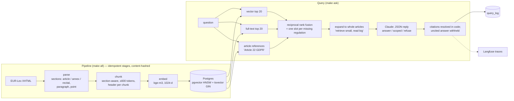

# reg-rag

Retrieval over EU AI and data regulation — the AI Act, GDPR and DORA — that
answers questions with article-level citations, or refuses.

Built because an answer about regulation is worthless without a traceable
source. That single constraint decides the architecture: retrieval rather
than fine-tuning, metadata carried through every stage, citations checked in
code rather than trusted from the model, and retrieval quality measured on
every change rather than eyeballed.

```text
$ make ask Q="What does Article 35 GDPR require a controller to do?"
[answer] claude-haiku-5-5, 12.6 s, $0.0011

Article 35 GDPR requires a controller, where a type of processing ... is likely
to result in a high risk to the rights and freedoms of natural persons, to carry
out, prior to the processing, an assessment of the impact ... [1]. The controller
must seek the advice of the data protection officer, where designated [1]. ...
Article 36 GDPR adds that where the assessment indicates a high risk in the
absence of mitigating measures, the controller must consult the supervisory
authority before processing [3].

Sources:
  [1] GDPR Article 35: Data protection impact assessment
  [3] GDPR Article 36: Prior consultation
trace: https://cloud.langfuse.com/project/.../traces/...
```

## Architecture



- **Parse** keeps the regulations' own structure: every section knows its
  regulation, article or annex, paragraph and point, so every chunk carries
  exactly the provision it came from.
- **Retrieve** fuses three rankings: dense vectors, Postgres full-text search,
  and a structural lookup of provisions the question names ("Article 12 of
  DORA" — a number that exists in all three regulations).
- **Answer** reads whole articles, replies through a fixed JSON schema, and
  never gets to cite something it was not given: source markers are resolved
  to provisions in code, and an answer left with no valid citation becomes a
  refusal.

## Results

All numbers are measured by `make eval` / `make eval-answers` on hand-written
question sets with article-level expected answers (see
[Evaluation](#evaluation) for how they were built and their limits).

### Retrieval (shipped configuration: section-aware chunks, recitals excluded)

| | hit@5 | recall@5 | context recall (all 8) | MRR | separation AUC |
|---|---|---|---|---|---|
| Tuning set (40 questions) | **0.867** | 0.728 | 0.889 | 0.740 | 0.870 |
| Held-out set (12 questions, run once) | **0.667** | 0.556 | 0.833 | 0.646 | 0.667 |
| + optional cross-encoder reranker (tuning set) | 0.933 | 0.778 | 0.889 | 0.817 | — |

The configuration was chosen on the tuning set, so its number is optimistic;
the held-out set, written afterwards and run once without tuning, estimates
by how much. With 9 answerable held-out questions, one question moves hit@5
by 0.11: read the true figure as roughly 0.7–0.85. The reranker
(bge-reranker-v2-m3) is off by default: it costs 4.3 s per search on an
M1 Pro against 33 ms without it.

How the tuning-set number was reached, one measured change at a time:

| Change | hit@5 | recall@5 | context recall | MRR |
|---|---|---|---|---|
| Hybrid search, section-aware chunks, recitals included | 0.667 | 0.544 | — | 0.447 |
| Exclude recitals (non-binding) by default | 0.767 | 0.628 | — | 0.606 |
| Structural lookup of named articles, pinned first | 0.867 | 0.728 | 0.778 | 0.740 |
| Reserve result slots for regulations the top results miss | 0.867 | 0.728 | **0.889** | 0.740 |

Chunking, same retrieval otherwise:

| Chunking | hit@5 | recall@5 | context recall | MRR | AUC | provisions per chunk |
|---|---|---|---|---|---|---|
| Section-aware (shipped) | 0.867 | 0.728 | 0.889 | 0.740 | 0.870 | 1.00 |
| Recursive (LangChain baseline) | 0.867 | 0.711 | 0.828 | 0.744 | 0.830 | 1.99 |

They tie on hit@5, but the tie flatters the baseline: a recursive chunk spans
two provisions on average and the eval credits it with every one it touches.
Section-aware chunks cite exactly one provision each, rank the second
regulation of a cross-document question better (context recall 0.889 vs
0.828), and separate in-scope from out-of-scope questions better.

### Answers (Claude Haiku 5.5, tuning set, 40 questions)

| Metric | Value |
|---|---|
| Behaviour accuracy (answer / scoped / refuse as expected) | **0.950** |
| Refusal accuracy | **0.975** — every must-refuse question refused |
| Citation recall (expected articles cited) | 0.889 |
| Answers withheld for lack of a valid citation | 0 |
| Cost of a full uncached run | $0.048 |

The largest single gain came from what the model reads, not from the
prompt: with chunk-sized sources behaviour accuracy was 0.775 (scoring
retrieval misses fairly); expanding each retrieved provision to its whole
article took it to 0.925, because "what does Article 35 require?" had
retrieved paragraph 11 and none of 1–10.

### CI gate

Every push and pull request runs lint, `mypy --strict`, the test suite (249
tests), and the retrieval eval on a checked-in fixture corpus embedded with
a deterministic offline encoder — no model download, built in about two
seconds. The build fails if hit@5 on the shipped configuration drops below
0.75 (measured: 0.767), or if the eval ran on fewer than the full 40
questions. `make eval-fixture` reproduces the CI job locally.

## Running it

Needs Docker, [uv](https://docs.astral.sh/uv/) and Python 3.12. The first
`make embed` downloads bge-m3 (about 2.2 GB) into the Hugging Face cache.

```bash
make db                      # Postgres + pgvector, migrations applied
make all                     # ingest, parse, chunk, embed, index
make eval                    # retrieval eval: 12 configurations, writes eval-report.md
uv run regrag ask "..." --retrieve-only   # retrieval only, no model call

# Answers need a Claude API key, in .env (never as a shell ANTHROPIC_API_KEY):
echo 'REGRAG_ANTHROPIC_API_KEY=sk-ant-...' >> .env
make ask Q="When must a company notify the supervisory authority of a data breach?"
make eval-answers            # answer eval; replies cached, so re-scoring is free

make check                   # ruff, mypy --strict, pytest
make eval-fixture            # CI's eval job, in a separate database
```

Everything is configured through `REGRAG_*` environment variables or `.env`
(see `src/regrag/config.py`), for example:

| Setting | Default | |
|---|---|---|
| `REGRAG_ANSWER_MODEL` | `claude-haiku-5-5` | any Claude model with structured outputs |
| `REGRAG_RERANK_MODEL` | empty (off) | `BAAI/bge-reranker-v2-m3` to rerank |
| `REGRAG_EXCLUDE_RECITALS` | `true` | `ask --include-recitals` per question |
| `REGRAG_LANGFUSE_ENABLED` | `false` | with `REGRAG_LANGFUSE_PUBLIC_KEY` / `_SECRET_KEY` |

## Design notes

**Hybrid retrieval.** Article references and defined terms are lexical;
obligations phrased in plain language ("a system it already sells does not
meet the rules") are semantic. Each side misses what the other finds, so the
vector and full-text rankings are fused with reciprocal rank fusion (k=60),
which needs no score calibration between them. Full-text search ORs the
question's Postgres lexemes rather than requiring all of them, so a long
question still matches.

**Named articles are looked up, not searched for.** "What does Article 12 of
DORA require?" — Article 12 exists in all three regulations, and both vector
and full-text search ranked the right one 13th to 34th. A parser resolves each reference to a
regulation (adjacent name first, then the nearest mention, then all in
scope), and the best chunk of each named provision is pinned to the top.

**One slot per missing regulation.** For cross-document questions the
question's embedding sits closer to one regulation, and the other's article
fell out of the top 8 — yet searched within its own regulation it ranked
first for 7 of the 10 missing halves. So the results' tail is reserved for the best chunk of
each regulation the head leaves out.

**Recitals are filterable, and filtered by default.** Recitals explain intent
but are not binding, and long recitals out-rank short articles in full-text
search. Excluding them was one of the two largest retrieval gains (+0.10
hit@5; 14 questions gained, 3 lost, and it won in all six strategy and
normalisation pairs); `--include-recitals` brings them back per question.

**Retrieve small, read big.** Chunks average 144 tokens, about a paragraph,
which ranks precisely. Before the model reads them, each retrieved provision
is expanded to its whole article or annex; an article over 8,000 characters
is cut to the retrieved paragraphs and their neighbours and marked as an
excerpt. The parser repeats a list's lead-in on every point (so each point
reads alone when retrieved); the expansion drops those repeats.

**Citations are derived, not trusted.** The model returns JSON through
structured outputs — the answer with `[n]` source markers, what the sources
do not cover, and a status. Markers are resolved to retrieved provisions in
code; a marker naming no source is dropped; an answer left without a valid
citation is withheld as a refusal.

**Refusal is the model's judgement, not a similarity threshold.** The eval
measures how well top-1 similarity separates in-scope from out-of-scope
questions (AUC 0.87), and the distributions overlap: on the held-out set, a
liability question the corpus cannot answer was closer to its nearest chunk
than every answerable question. A threshold would refuse good questions
and answer bad ones, so the prompt decides, with three outcomes: answer,
scoped (answer the supported part, name what is missing), or refuse.

**Observability.** Every `ask` is written to `query_log` (question, retrieved
chunks, answer, status, citations, tokens, cost, latency). With Langfuse
enabled, each question is also a trace with a retriever span and a generation
(prompt, reply, tokens, cost); answer-eval runs become a session with
per-question scores (`behaviour_ok`, `refusal_ok`, `citation_recall`).

## Evaluation

- **40 tuning questions**, 10 per category: direct lookup ("What does Annex
  III list?"), obligation in plain language, cross-document (two regulations
  needed), and out-of-scope (other laws, national law, future amendments —
  including traps whose subject the corpus *mentions* but does not regulate).
- **12 held-out questions**, written after the configuration was frozen and
  run once.
- Expected answers are *minimal sufficient* sets of articles, each checked
  against the regulation text and against the parsed corpus on every run.
  Review found and fixed six defects in the questions themselves (an
  expected article that did not impose the duty, a deadline the regulation
  delegates to later standards, a corpus-presence claim based on line
  counts); the loader now validates every field.
- Retrieval metrics: hit@5 (the gate), recall@5, context recall over all 8
  results, MRR, separation AUC. Answer metrics are deterministic — status
  against the expected behaviour, citations against the expected articles —
  with no grader model.

What it does not cover: questions are written by the builder of the system;
52 questions give wide error bars (one question is 3 points on the tuning
set, 11 on the held-out set); answers are scored on status and citations,
not on whether every sentence is faithful to its source.

## Limitations

- **Three regulations, as retrieved.** No other EU acts, no national law, no
  delegated or implementing acts (DORA's reporting deadlines, for example, are
  set in technical standards that are not indexed), no case law, no
  amendments after the retrieval date.
- **Cross-references are not followed.** Article 11 AI Act says the
  documentation must contain "the elements set out in Annex IV"; unless Annex
  IV was itself retrieved, the answer says it is missing rather than fetching
  it.
- **Synthesis is shallow.** Questions needing more than two or three
  provisions, or applying a requirement to a concrete system, are beyond what
  the eval tests and what eight retrieved chunks can carry.
- **Cross-document recall is the weak spot:** recall@5 is 0.38 on those
  questions; the coverage slots raise what the model reads to 0.77, not to 1.
- **The answer model is the cheapest one.** Haiku 5.5 was chosen for cost; a
  comparison with larger models is not done yet.
- **Not deployed.** `infra/` holds a Terraform draft for an AWS deployment
  (an S3 bucket for the raw corpus; the database, IAM role and Amazon Bedrock
  access are still to do) that has never been applied. The project runs
  locally against Docker Postgres and the Claude API.

This is a retrieval and drafting aid, not a compliance opinion.

## Data

The regulation texts are fetched from [EUR-Lex](https://eur-lex.europa.eu/)
(reuse authorised under Commission Decision 2011/833/EU) and are not
committed, except for the excerpts in `tests/fixtures/corpus.json` that CI's
offline eval runs on.
